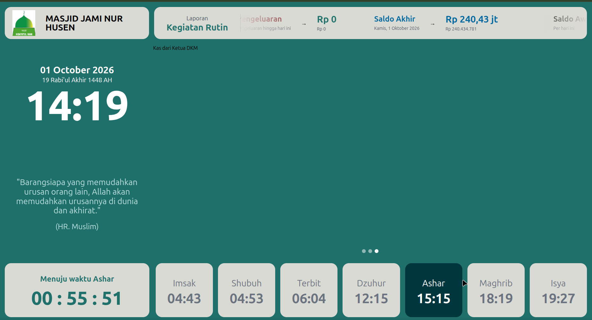

<div align="center">

# 🕌 Masjid An-Nur

**Aplikasi manajemen masjid modern: keuangan kas, jadwal kajian & khatib, serta layar TV jadwal shalat. Semua dalam satu aplikasi.**

[](https://go.dev/)
[](https://gofiber.io/)
[](https://react.dev/)
[](https://www.typescriptlang.org/)
[](https://vite.dev/)
[](https://tailwindcss.com/)
[](https://www.postgresql.org/)
[](https://www.docker.com/)

[Fitur](#-fitur-utama) •
[Tangkapan Layar](#-tangkapan-layar) •
[Teknologi](#-teknologi) •
[Memulai](#-memulai) •
[Konfigurasi](#%EF%B8%8F-konfigurasi) •
[API](#-dokumentasi-api) •
[Deploy](#-deploy-production)

</div>

---

## 📖 Tentang

**Masjid An-Nur** adalah aplikasi web untuk membantu pengurus (takmir) masjid mengelola administrasi harian secara transparan dan rapi. Pencatatan kas masuk/keluar, laporan keuangan, penerbitan kwitansi, jadwal kajian, sampai tampilan **layar TV masjid** berisi jadwal shalat dan informasi kas bisa dikerjakan dari satu dashboard.

Aplikasi ini mendukung **banyak masjid sekaligus (multi-tenant)**. Setiap pengguna yang mendaftar otomatis mendapat *workspace* masjidnya sendiri, dan data setiap masjid terpisah satu sama lain.

## ✨ Fitur Utama

| Modul | Deskripsi |
|---|---|
| 💰 **Buku Kas** | Kelola beberapa buku kas (mis. *Kas Umum*, *Kas Pembangunan*, *Kas Anak Yatim*). |
| 🏷️ **Kategori** | Kategori pemasukan & pengeluaran yang bisa diatur sendiri. |
| 🧾 **Transaksi** | Catat pemasukan & pengeluaran, lalu cetak **kwitansi** (PNG ukuran A6, siap kirim lewat WhatsApp atau dicetak). |
| 📊 **Laporan** | Laporan bulanan, per kategori, dan mingguan, bisa diekspor ke **Excel (.xlsx)**. |
| 🎤 **Jadwal Kajian & Khatib** | Atur jadwal pengajian, khatib Jumat, dan penceramah. |
| 📺 **Layar TV Masjid** | Halaman publik `/display` untuk TV: jam, tanggal Masehi & Hijriah, **jadwal shalat otomatis** (parameter Kemenag), hitung mundur ke shalat berikutnya, info kas, dan jadwal kajian. Data diperbarui otomatis setiap 60 detik. |
| ⚙️ **Profil Masjid** | Nama, alamat, koordinat lokasi (untuk jadwal shalat), dan identitas masjid. |
| 👥 **Pengguna & Peran** | Manajemen user dengan **RBAC** (Role-Based Access Control) berbasis izin per modul. |
| 🔐 **Autentikasi** | Login email/password, **Login dengan Google (OAuth2)**, lupa & reset password lewat email, ganti password. |

### Peran bawaan

| Peran | Hak akses |
|---|---|
| `superadmin` | Pengelola platform; melihat dan mengatur seluruh masjid, termasuk mengubah peran global. |
| `admin` | Akses penuh ke semua modul di masjidnya sendiri. |
| `bendahara` | Mengelola buku kas, kategori, transaksi, dan laporan. |
| `user` | Peran default akun baru; dashboard dan laporan (hanya baca). |

## 📸 Tangkapan Layar

<div align="center">
  
  <p><em>Layar TV masjid (<code>/display</code>): jadwal shalat, hitung mundur, dan informasi masjid</em></p>
</div>

## 🛠 Teknologi

**Backend**
- [Go](https://go.dev/) + [Fiber v2](https://gofiber.io/): web framework yang cepat
- [GORM](https://gorm.io/) dengan PostgreSQL (SQLite juga didukung)
- JWT (`golang-jwt/jwt/v5`) untuk autentikasi, `bcrypt` untuk hash password
- `golang.org/x/oauth2` untuk Login Google
- SMTP untuk email reset password
- [Air](https://github.com/air-verse/air) untuk *hot-reload* saat development

**Frontend**
- [React 19](https://react.dev/) + [TypeScript](https://www.typescriptlang.org/) + [Vite](https://vite.dev/)
- [Tailwind CSS v4](https://tailwindcss.com/) + [shadcn/ui](https://ui.shadcn.com/) (Radix UI)
- [React Router v7](https://reactrouter.com/)
- [Lucide](https://lucide.dev/) icons, font Geist
- `xlsx` untuk ekspor Excel, `html-to-image` untuk kwitansi PNG

**Infrastruktur**
- Docker & Docker Compose
- Traefik (reverse proxy) + Cloudflare Tunnel untuk production

## 📁 Struktur Proyek

```
masjidannur/
├── backend/                  # REST API (Go + Fiber)
│   ├── cmd/server/main.go    # Entry point, migrasi & seeding data awal
│   ├── config/               # Pembacaan environment variable
│   ├── internal/
│   │   ├── handlers/         # HTTP handler
│   │   ├── models/           # Model GORM (User, Role, Book, Transaction, ...)
│   │   ├── repository/       # Akses database
│   │   ├── routes/           # Definisi routing API
│   │   └── service/          # Logika bisnis
│   ├── pkg/
│   │   ├── jwt/              # Utilitas token JWT
│   │   └── middleware/       # RequireAuth, RequirePermission, dll.
│   └── .air.toml             # Konfigurasi hot-reload
├── frontend/                 # SPA (React + Vite)
│   └── src/
│       ├── components/       # Komponen UI (shadcn/ui, tabel, kwitansi, layout admin)
│       ├── context/          # AuthContext
│       ├── lib/              # API client, tipe, kalkulasi jadwal shalat
│       └── pages/            # Halaman (Landing, Admin, Display, Auth, ...)
├── scripts/db-setup.sh       # Helper membuat/reset database
├── docker-compose.prod.yml   # Stack production (FE + BE + DB)
└── Makefile                  # Perintah singkat dev & production
```

## 🚀 Memulai

### Prasyarat

- [Go](https://go.dev/dl/) 1.26+
- [Node.js](https://nodejs.org/) 22+ dan npm
- [Docker](https://docs.docker.com/get-docker/) (untuk PostgreSQL)
- [Air](https://github.com/air-verse/air) (opsional, untuk hot-reload backend): `go install github.com/air-verse/air@latest`

### 1. Clone repositori

```bash
git clone https://github.com/ermanjunaidi/masjidannur.git
cd masjidannur
```

### 2. Siapkan environment

```bash
# Backend
cp backend/.env.example backend/.env

# Frontend
cp frontend/.env.example frontend/.env
```

Sesuaikan isi `backend/.env` (lihat [Konfigurasi](#%EF%B8%8F-konfigurasi)).

### 3. Jalankan database

```bash
make db-up        # Menjalankan PostgreSQL 15 di Docker (port 5432)
```

### 4. Install dependensi frontend

```bash
cd frontend && npm install && cd ..
```

### 5. Jalankan aplikasi

```bash
make dev          # Backend (Air) + Frontend (Vite), keduanya dengan hot-reload
```

Atau jalankan masing-masing secara manual:

```bash
# Terminal 1: Backend
cd backend && go run ./cmd/server

# Terminal 2: Frontend
cd frontend && npm run dev
```

Buka **http://localhost:5173** di browser. Saat pertama kali dijalankan, backend otomatis membuat tabel, katalog izin dan peran, buku kas default *"Kas Umum"*, serta akun demo.

### 🔑 Akun demo (development)

| Peran | Email | Password |
|---|---|---|
| Super Admin | `superadmin@example.com` | `superadmin123` |
| Admin Masjid | `admin@example.com` | `admin123` |
| Bendahara | `bendahara@example.com` | `bendahara123` |
| User | `user@example.com` | `user123` |

> ⚠️ Di production (`APP_ENV=production`) password default **tidak** dipakai. Atur lewat `SEED_SUPERADMIN_PASSWORD`, `SEED_ADMIN_PASSWORD`, `SEED_BENDAHARA_PASSWORD`, dan `SEED_USER_PASSWORD`.

## ⚙️ Konfigurasi

### Backend (`backend/.env`)

| Variabel | Default | Keterangan |
|---|---|---|
| `APP_ENV` | `development` | `development` atau `production` |
| `APP_PORT` | `3000` | Port server API |
| `DATABASE_URL` | – | Connection string PostgreSQL (jika diisi, menggantikan `DB_*`) |
| `DB_HOST` / `DB_PORT` | – / `5432` | Host & port database |
| `DB_USER` / `DB_PASSWORD` | `postgres` / `postgres` | Kredensial database |
| `DB_NAME` | `master_db` | Nama database |
| `DB_SSLMODE` | `disable` | Mode SSL PostgreSQL |
| `JWT_SECRET` | `supersecret` | **Wajib diganti** di production |
| `FRONTEND_URL` | `http://localhost:5178` | URL frontend (untuk tautan reset password & redirect OAuth) |
| `ALLOWED_ORIGINS` | – | Daftar origin CORS, dipisah koma |
| `GOOGLE_CLIENT_ID` | – | OAuth2 Google (opsional) |
| `GOOGLE_CLIENT_SECRET` | – | OAuth2 Google (opsional) |
| `GOOGLE_REDIRECT_URL` | – | mis. `https://api.domain.com/api/auth/google/callback` |
| `SMTP_HOST` / `SMTP_PORT` | – / `587` | Server SMTP untuk email reset password |
| `SMTP_USER` / `SMTP_PASSWORD` | – | Kredensial SMTP |
| `SMTP_FROM` | `no-reply@masjidannur.my.id` | Alamat pengirim email |

### Frontend (`frontend/.env`)

| Variabel | Keterangan |
|---|---|
| `VITE_API_URL` | URL backend. Kosongkan saat development (memakai proxy Vite), isi saat production, mis. `https://api.masjidannur.my.id` |
| `VITE_PORT` | Port dev server Vite (default `5173`) |

## 📡 Dokumentasi API

Semua endpoint diawali `/api`. Endpoint yang dilindungi membutuhkan header `Authorization: Bearer <token>` dan izin (*permission*) yang sesuai.

<details>
<summary><b>🌐 Publik</b></summary>

| Method | Endpoint | Keterangan |
|---|---|---|
| `GET` | `/public/display` | Data layar TV (masjid default) |
| `GET` | `/public/display/:slug` | Data layar TV untuk masjid tertentu |
| `POST` | `/auth/register` | Daftar akun + workspace masjid baru |
| `POST` | `/auth/login` | Login, mengembalikan JWT |
| `POST` | `/auth/forgot-password` | Kirim email reset password |
| `POST` | `/auth/reset-password` | Reset password dengan token |
| `GET` | `/auth/google` | Mulai login Google |
| `GET` | `/auth/google/callback` | Callback OAuth Google |

</details>

<details>
<summary><b>🔐 Terautentikasi</b></summary>

| Method | Endpoint | Izin |
|---|---|---|
| `GET` | `/auth/me` | – |
| `PUT` | `/auth/password` | – |
| `GET` `POST` | `/books` | `books:read` / `books:write` |
| `GET` `PUT` `DELETE` | `/books/:id` | `books:read` / `books:write` / `books:delete` |
| `GET` `POST` | `/categories` | `categories:read` / `categories:write` |
| `PUT` `DELETE` | `/categories/:id` | `categories:write` / `categories:delete` |
| `GET` `POST` | `/transactions` | `transactions:read` / `transactions:write` |
| `PUT` `DELETE` | `/transactions/:id` | `transactions:write` / `transactions:delete` |
| `GET` | `/reports/monthly` · `/reports/category` · `/reports/weekly` | `reports:read` |
| `GET` `POST` | `/lecturings` | `lecturings:read` / `lecturings:write` |
| `PUT` `DELETE` | `/lecturings/:id` | `lecturings:write` / `lecturings:delete` |
| `GET` `PUT` | `/masjid-settings` | `settings:read` / `settings:write` |
| `GET` `POST` | `/users` | `users:read` / `users:write` |
| `GET` `PUT` `DELETE` | `/users/:id` | `users:read` / `users:write` / `users:delete` |
| `GET` | `/roles` · `/permissions` | `roles:read` |
| `POST` `PUT` `DELETE` | `/roles[/:id]` | `roles:write` / `roles:delete` + **platform admin** |

</details>

## 🗺️ Halaman Frontend

| Rute | Halaman |
|---|---|
| `/` | Landing page |
| `/display`, `/display/:slug` | Layar TV masjid (publik, mode kiosk) |
| `/login`, `/register` | Masuk & daftar |
| `/forgot-password`, `/reset-password` | Pemulihan akun |
| `/admin` | Dashboard |
| `/admin/books` | Buku kas |
| `/admin/categories` | Kategori |
| `/admin/transactions` | Transaksi & kwitansi |
| `/admin/reports` | Laporan keuangan |
| `/admin/lecturings` | Jadwal kajian & khatib |
| `/admin/users` | Pengguna & peran |
| `/admin/security` | Keamanan akun |
| `/admin/settings` | Profil masjid |

> 💡 **Tips layar TV:** buka `/display` di Smart TV atau mini PC, lalu aktifkan mode layar penuh (F11) atau kiosk browser. Koordinat di *Profil Masjid* dipakai untuk menghitung jadwal shalat.

## 🐳 Deploy Production

Seluruh stack (frontend, backend, PostgreSQL) berjalan di Docker lewat `docker-compose.prod.yml`, dengan Traefik sebagai reverse proxy dan Cloudflare Tunnel untuk TLS.

```bash
# 1. Siapkan environment production
cp backend/.env.example .env.production   # lalu sesuaikan nilainya

# 2. Build & jalankan semua container
make up

# 3. Pantau
make ps       # status container
make logs     # log semua service
make down     # hentikan
```

Pola domain:
- Frontend: `masjidannur.my.id`
- Backend: `api.masjidannur.my.id`

Lihat juga [`frontend/DEPLOY.md`](frontend/DEPLOY.md) untuk detail deploy frontend.

### Checklist keamanan production

- [ ] Ganti `JWT_SECRET` dengan string acak yang panjang
- [ ] Atur semua `SEED_*_PASSWORD`
- [ ] Isi `ALLOWED_ORIGINS` hanya dengan domain frontend Anda
- [ ] Gunakan password database yang kuat
- [ ] Jangan pernah commit file `.env` / `.env.production`

## 🧰 Perintah Makefile

| Perintah | Fungsi |
|---|---|
| `make help` | Tampilkan daftar perintah |
| `make dev` | Jalankan backend + frontend (hot-reload) |
| `make db-up` / `make db-down` | Start / stop PostgreSQL lokal di Docker |
| `make db-shell` | Masuk ke `psql` |
| `make up` / `make down` | Start / stop stack production |
| `make ps` / `make logs` | Status & log container production |

## 🤝 Kontribusi

Kontribusi sangat terbuka, baik laporan bug, ide fitur, maupun pull request.

1. Fork repositori ini
2. Buat branch fitur: `git checkout -b fitur/nama-fitur`
3. Commit perubahan: `git commit -m "tambah fitur X"`
4. Push ke branch: `git push origin fitur/nama-fitur`
5. Buka Pull Request

Sebelum mengirim PR, pastikan:

```bash
cd backend && go build ./... && go test ./...
cd frontend && npm run lint && npm run build
```

## 📄 Lisensi

Belum ada lisensi yang ditentukan. Hubungi pemilik repositori sebelum menggunakan kode ini untuk keperluan lain.

---

<div align="center">

Dibuat dengan ❤️ untuk kemakmuran masjid.

*"Hanyalah yang memakmurkan masjid-masjid Allah ialah orang-orang yang beriman kepada Allah dan hari kemudian..."* (QS. At-Taubah: 18)

</div>
